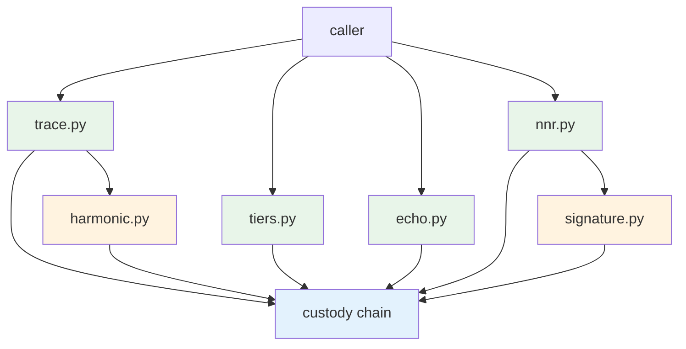

# vega-trace-sdk — Architecture

## At a glance

| Item | Value |
|------|-------|
| Version | 0.1.0 |
| Layer | 10 — observe |
| Status | Reference implementation; not independently security-reviewed; crypto not expert-reviewed |
| Dependencies | vega-custody-sdk (layer 0) |

## Table of contents

- [The organism (family picture)](#1-the-organism-family-picture)
- [Internal drawing](#2-internal-drawing)
- [Mermaid version](#3-mermaid-version)
- [Sequence: main scenario end to end](#4-sequence-main-scenario-end-to-end)
- [Trust boundaries](#5-trust-boundaries)

## 1. The organism (family picture)

```text
                 ┌──────────────────────────┐
                 │   THE HUMAN (the owner)  │  holds the only signing key;
                 │  authority starts here   │  spends it one action at a time
                 └────────────┬─────────────┘
                              v single-use signed commitments
 15 assemble   vega-umbrella-sdk        the family as one organism: one keyed
                                        ledger, one approval check, one anchor,
                                        registry + pre-deploy audit
 14 deliberate vega-council-sdk         multi-brain deliberation, design-first builder
               vega-galaxy-sdk          the galaxy view of the knowledge lattice:
                                        levels, convergence, futures above the present
 13 watch      vega-governance-feed-sdk  live view of every chain + tamper alarms
 12 verify     vega-metacog-sdk          evidence rungs and the completion gate
 11 reason     vega-reasoning-sdk        fidelity, forecasting, routing: the lattice
                                        that predicts steps ahead
 10 observe >>> vega-trace-sdk <<<       telemetry of reasoning: layer traces, entropy,
                                        harmonic echo, reference signature
  9 interface  vega-terminal-sdk         gated command execution for people and agents
  8 learn      vega-train-sdk            governed training + freeze cards: records
                                        exactly what a model learned from
  7 knowledge  vega-dkg-lattice-sdk      the knowledge graph: every fact with origin
                                        and licence; repo-library processing
  6 conduct    vega-harness-sdk          deterministic workflow conduct, pre-registered
                                        predicted paths, library use gate
  5 memory     vega-librarian-sdk        lessons and memory of past incidents
  4 contain    vega-two-gate-sdk         containment between two gates + the hard stop
  3 adapt      vega-pareah-sdk           adapters, cards, quarantine of inbound code:
                                        the dead-end room for the unannounced
  2 seal       vega-superproof-sdk       layered sealing and proof tiers
  1 authority  vega-governance-jacket-sdk human-only actions, single-use signed
                                        commitments, entry and exit gates
  0 record     vega-custody-sdk          capsules, DAG, hash-chained ledger, safe paths,
                                        bounded processes — the foundation everything
                                        writes to
```

**What layers below provide:** Layer 0 (custody) provides the append-only, hash-chained DAG where every trace record lands as `TRACE_<KIND>`. The `contains_credential` check refuses any trace carrying credential-shaped content.

**Who above consumes it:** Layer 11 (reasoning) uses trace telemetry to forecast fidelity; layer 12 (metacog) gates completion on evidence; layer 13 (feed) shows live trace chains; layer 14 (council/galaxy) deliberates with trace-informed foresight.

**One family, one organism:** every SDK owns exactly one concern and uses the owner of every other concern instead of growing its own copy.

## 2. Internal drawing

```
┌─────────────────────────────────────────────────────────────────┐
│                        vega-trace-sdk                           │
│  ┌──────────────┐  ┌──────────────┐  ┌──────────────────────┐  │
│  │   trace.py   │  │  harmonic.py │  │       echo.py        │  │
│  │  (3 traces)  │──▶│  (melody +   │  │  (repeat-run echo)   │  │
│  │              │   │   score +    │  │                      │  │
│  │ mapping      │   │   WAV)       │  │ harmonics()          │  │
│  │ metamorphosis│   │              │  │ echo() + judge       │  │
│  │ breathing    │   │ compare_     │  │                      │  │
│  │ record()     │   │ clarity()    │  │                      │  │
│  └──────┬───────┘  └──────┬───────┘  └──────────┬───────────┘  │
│         │                 │                       │             │
│         ▼                 ▼                       ▼             │
│  ┌──────────────────────────────────────────────────────────┐  │
│  │              custody chain (vega-custody-sdk)             │  │
│  │  TRACE_MAPPING  TRACE_METAMORPHOSIS  TRACE_BREATHING      │  │
│  │  TRACE_ECHO (harmonic)  TRACE_ECHO (repeat-run)           │  │
│  └──────────────────────────────────────────────────────────┘  │
│         ▲                 ▲                       ▲             │
│         │                 │                       │             │
│  ┌──────┴───────┐  ┌──────┴───────┐  ┌──────────┴───────────┐  │
│  │  tiers.py    │  │ signature.py │  │      nnr.py          │  │
│  │  (tier       │  │  (reference  │  │  (ObserveLedger,     │  │
│  │   boundary)  │  │   signature, │  │   stamp/grade,       │  │
│  │              │  │   asserted   │  │   commit_trace,      │  │
│  │ telemetry()  │  │   value,     │  │   prove_derivation)  │  │
│  │ cue()        │  │   calibrate, │  │                      │  │
│  │              │  │   atlas)     │  │                      │  │
│  └──────────────┘  └──────────────┘  └──────────────────────┘  │
└─────────────────────────────────────────────────────────────────┘

DATA FLOW (records):  caller → trace/harmonic/echo/tiers/signature/nnr → custody chain
AUTHORITY FLOW:       human commitment → jacket gates → contained execution → record
                      (this SDK has no authority flow; it only produces telemetry records)
```

**Box-to-module mapping:** Every box is a real module in `src/vega_trace/`. No invented modules.

## 3. Mermaid version



## 4. Sequence: main scenario end to end

```text
# Scenario: record a tier-1 trace and score its harmonic echo

caller                          trace.py                    harmonic.py              custody chain
  │                                │                            │                       │
  ├─ metamorphosis_record(         │                            │                       │
  │   step_id="s1",                │                            │                       │
  │   layers=[{layer:0, in:...,    │                            │                       │
  │            out:...}, ...]     │                            │                       │
  │  )────────────────────────────▶│                            │                       │
  │                                │ validates, digests,        │                       │
  │                                │ returns record             │                       │
  │◀───────────────────────────────┤                            │                       │
  │                                │                            │                       │
  ├─ record(dag, rec)─────────────▶│                            │                       │
  │                                │ contains_credential?       │                       │
  │                                │───────────────────────────▶│                       │
  │                                │◀────────────── no          │                       │
  │                                │ appends TRACE_METAMORPHOSIS│                       │
  │                                │                            │                       │
  │◀───────────────────────────────┤                            │                       │
  │                                │                            │                       │
  ├─ melody(metamorphosis_rec)────────────────────────────────▶│                       │
  │                                │                            │ semitones, notes      │
  │                                │◀───────────────────────────│                       │
  │                                │                            │                       │
  ├─ score(notes)─────────────────────────────────────────────▶│                       │
  │                                │                            │ clarity, verdict      │
  │                                │◀───────────────────────────│                       │
  │                                │                            │                       │
  ├─ echo_record("s1", notes)──────▶│                            │                       │
  │                                │                            │                       │
  ├─ record(dag, echo_rec)────────▶│                            │                       │
  │                                │                            │ appends TRACE_ECHO    │
  │                                │                            │ (harmonic kind)       │
  │                                │                            │                       │
  │◀───────────────────────────────┤                            │                       │
```

## 5. Trust boundaries

| Boundary | What changes hands | Enforcer |
|----------|-------------------|----------|
| caller → trace.py | caller supplies layer data / timings; trace.py validates, digests, refuses bad input | `TraceRefused` exceptions on every validation |
| trace.py → custody chain | trace record (hashes/scalars only) | `contains_credential` refuses credential-shaped content; chain appends hash-chained |
| caller → harmonic.py | metamorphosis record → melody notes → score | `HarmonicRefused` on non-metamorphosis, bad fields, non-finite norms |
| caller → echo.py | run function + variations → echo texts (hashed only) | `EchoRefused` on bad callable, count, size; chain stores only hashes |
| caller → tiers.py | declared access tier + data | `TierRefused` if data exceeds tier (enforces tier boundary) |
| tiers.py → caller | advice-only cue (never authority) | `grants_authority: False` hardcoded |
| caller → signature.py | FACT-grade vectors + committed=True | `SignatureRefused` on non-FACT, non-committed, wrong length |
| signature → caller | asserted value (None until 10 verified) | returns None, not zero, when basis insufficient |
| caller → nnr.py | head profiles, expectations, trace records | `NnrRefused` on bad class, digests, magnitudes; `ProofUnavailable` on ZK proof |
| nnr.py → custody chain | `TRACE_NNR007`, `TRACE_STAMP`, `TRACE_COMMIT` | chain validates; stamp tamper detected on grade |

> **No model-side trust boundary:** this SDK never calls a model, never holds a signing key, never grants authority. It only produces telemetry records that land in the custody chain.