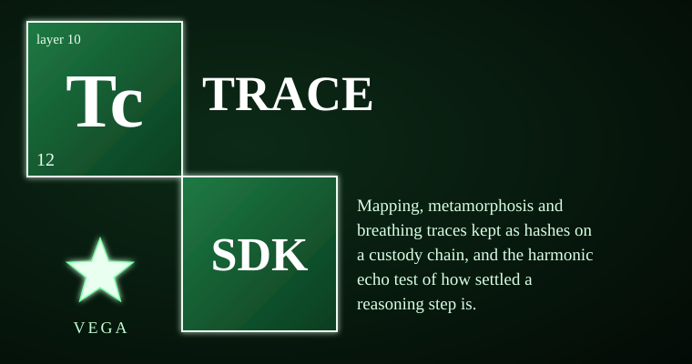

# vega-trace-sdk



Telemetry of reasoning: three per-step traces kept as hashes and scalars on a custody chain, and the harmonic echo test that scores how settled a reasoning step sounds. This kit owns the **observe** concern — what happened, captured honestly at every access tier, without ever holding raw activations.

## At a glance

| Item | Value |
|------|-------|
| Version | 0.1.0 |
| Status | Reference implementation; not independently security-reviewed; crypto not expert-reviewed |
| Tests | 78 tests in 6 files, all passing (STATUS.md, REVIEW.md) |
| Platform | Windows, macOS, Linux (CPython 3.10+) |
| Layer | 10 — observe |

> **Licensing.** Source-available, not open source. Free for personal use; free for registered small businesses (under US$1M revenue and valuation); everyone else needs a commercial license (see LICENSE; for a commercial license write to jasonblasiak.ai.mail@gmail.com). Patent pending. Draft licence text, not yet reviewed by an attorney.

## What it is

vega-trace-sdk provides **telemetry of reasoning** at three access tiers. It records where a step went (mapping), what it became (metamorphosis), and how it breathed (external timing) — all as digests and scalars appended to a hash-chained custody chain. It also provides the **harmonic echo** (audible trace scoring) and a **repeat-run echo** (stability test across variations), plus a reference signature for verified assertions and staged NNR pieces for head-profile observation.

## Specifications

| Item | Value |
|------|-------|
| Version | 0.1.0 |
| Python | >= 3.10 |
| Dependencies | vega-custody-sdk (runtime) |
| Tests | 78 tests in 6 files, all passing (see STATUS.md, REVIEW.md) |
| Status | Reference implementation; not independently security-reviewed; crypto not expert-reviewed |

## End-to-end functions

1. **Record a trace** — caller provides layer data (mapping/metamorphosis) or external timings (breathing) → `trace.mapping_record` / `metamorphosis_record` / `breathing_record` validates, digests, and returns a record → `trace.record(dag, rec)` appends to custody chain as `TRACE_MAPPING`, `TRACE_METAMORPHOSIS`, or `TRACE_BREATHING`.
2. **Compare two traces** — `trace.compare(a, b)` reports identical/differing layers or breathing mean ratio; refuses mixed kinds or steps.
3. **Score the harmonic echo** — `harmonic.melody(metamorphosis_record)` maps per-layer norm changes to semitones → `harmonic.score(notes)` returns dissonance, stuck-share, clarity, and verdict (CLEAR / MUDDY / DISSONANT / STUCK) → `harmonic.render_wav(notes, path)` writes deterministic mono WAV.
4. **Run repeat-echo stability** — `echo.echo(run, step_id, variations)` calls caller's function N times, computes fundamental/overtones/resonance/verdict (STABLE / MIXED / UNSTABLE), optionally records to chain with hashes only.
5. **Telemetry by access tier** — `tiers.telemetry(access, step_id, data)` refuses data the tier cannot see: weights → layers+consulted; probabilities → per_token_probs; text → timings_ns only. `tiers.cue(record)` returns advice-only flags (high entropy share, uneven timing); never grants authority.
6. **Reference signature & calibration** — `signature.ReferenceSignature` accumulates FACT-grade committed vectors → `asserted_value(vector)` returns RMS z-distance (None until 10 verified) → `signature.calibrate(verified, failed)` reports mean difference with counts and small-sample warning.
7. **Staged NNR pieces** — `nnr.ObserveLedger(dag)` records head profiles with capsule-head pointers and body digests; `nnr.stamp/grade` commits expectations before a run, grades HIT/MISS after (misses kept); `nnr.commit_trace/open_commitment` HMAC-SHA256 with salt+key, constant-time verify; `nnr.prove_derivation` raises `ProofUnavailable` (fail closed).

## Controls

| Knob / entry point | What it does |
|--------------------|--------------|
| `trace.MAX_LAYERS` (512), `MAX_POSITIONS` (4096), `MAX_TIMINGS` (100000) | Hard caps on trace size; exceed → `TraceRefused` |
| `harmonic.MAX_LAYERS_RENDERED` (512), `SAMPLE_RATE` (22050), `NOTE_SECONDS` (0.15) | WAV render limits and audio parameters |
| `harmonic.CONSONANT` (frozenset of semitone intervals) | Consonance definition for dissonance scoring |
| `echo.MAX_ECHOES` (64), `MAX_CHARS` (1MiB), `STOP` (stopword set) | Echo batch size, text cap, word filtering |
| `tiers.MAX_TOKENS` (100000), `MAX_VOCAB` (1000000) | Entropy distribution limits |
| `tiers.cue(high_share=0.5, cv=1.0)` | Advice thresholds (configurable per call) |
| `signature.MIN_FOR_SIGNATURE` (10) | Minimum verified assertions before `asserted_value` returns a number |
| `signature.STATUSES`, `FEATURES` | Epistemic status labels and entropy feature vector keys |
| `nnr.CLASSES` (computational/cache/novel), `MAX_HEADS` (4096) | Prompt classes and head-profile size cap |
| `nnr.prove_derivation` | Always raises `ProofUnavailable` — zero-knowledge backend not registered |

## What it CANNOT do

- Not production-hardened; reference implementation with tests only.
- Not independently security-reviewed.
- Cryptography not expert-reviewed; do not protect real secrets with it.
- Cannot read activations from a model — caller must supply layer data; no model hook is included.
- Semantic (embedding/entailment) judge for echoes is a plug-in point; built-in comparison is word overlap only.
- A stable echo is not a correct answer: all echoes can agree and be wrong.
- Breathing traces show external timing, not content; sensitive to machine load.
- The harmonic note mapping is a convention; clarity-tracking-correctness is a hypothesis tested by `compare_clarity`, not a finding.
- Zero-knowledge proof of trace derivation is not built; `prove_derivation` fails closed.
- Tier-3 (text-only) requests carrying layer or probability data are refused, not quietly accepted.

## Platform support

| Platform | Support |
|----------|---------|
| Windows | Full (CPython 3.10+) |
| macOS | Full (CPython 3.10+) |
| Linux | Full (CPython 3.10+) |
| Android | Via Termux Python runtime only; no native .apk |
| iOS | Via BeeWare/Kivy Python runtime only; no native .ipa |

Runs anywhere CPython 3.10+ runs. Pure Python with no POSIX-only code (no `os.fork`, `setsid`, signals, `/proc`, `fcntl`, `termios`, or `/tmp` dependencies).

No hardware-dependent capabilities (GPU/TPM/hardware keys) are present.

## Standalone & unified install

**Standalone:** `pip install -e .` installs with its declared dependency `vega-custody-sdk` only. Imports no other family SDKs. Installs and runs alone with zero family dependencies beyond the custody foundation.

**Unified:** Registered in vega-umbrella-sdk's registry as layer 10 (observe). Registry entry verbatim from `vega-umbrella-sdk/src/vega_umbrella/registry.py`:

```text
vega-trace-sdk | 10 observe | custody
```

The umbrella resolves inter-SDK wiring; this kit depends only on the custody layer (layer 0).

## Diagnostic control surface

- **CLI entry points:** none (no `console_scripts` in pyproject.toml).
- **Introspection functions:** `trace.compare`, `harmonic.score`, `echo.harmonics`, `signature.asserted_value`, `signature.calibrate`, `signature.atlas`, `nnr.ObserveLedger.determinism`, `nnr.ObserveLedger.class_similarity`, `tiers.cue` — all return plain dicts with counts, ratios, and verdicts.
- **Log surface:** none (no structured logging; records go to the custody chain).
- **Exit codes / fail-closed indicators:** every validation function raises a typed `*Refused` exception on bad input; chain recording refuses credential-shaped content; `prove_derivation` raises `ProofUnavailable` (fail closed).
- **Environment variables honored:** none.

A diagnostic UI design for this layer exists in the Vega OS interface program; it is not shipped with this package.

## Fail-closed constraints & custom constraints

### Fail-closed points (module + function)

| Module + function | Mechanism |
|-------------------|-----------|
| `trace.digest_vector` | Refuses non-finite, non-numeric, oversized vectors (`TraceRefused`) |
| `trace.mapping_record` | Refuses bad step ids, duplicate layers, oversized position lists, extra keys (`TraceRefused`) |
| `trace.metamorphosis_record` | Refuses bad layer entries, non-finite norms (`TraceRefused`) |
| `trace.breathing_record` | Refuses negative timings, too few/too many samples (`TraceRefused`) |
| `trace.record` | Refuses non-trace kinds, credential-shaped content via `contains_credential` (`TraceRefused`) |
| `harmonic.melody` | Refuses non-metamorphosis records, non-boolean `changed`, non-finite norms (`HarmonicRefused`) |
| `harmonic.render_wav` | Refuses >512 notes (`HarmonicRefused`) |
| `echo.harmonics` / `echo.echo` | Refuses bad run callable, wrong variation count, oversized text, non-string returns (`EchoRefused`) |
| `tiers.telemetry` | Refuses data the declared access tier cannot see (enforces tier boundary; `TierRefused`) |
| `tiers.entropy_bits` | Refuses non-distributions (bad sums, negatives, NaN; `TierRefused`) |
| `signature.ReferenceSignature.add_verified` | Refuses non-FACT grade or non-True committed (`SignatureRefused`) |
| `signature.asserted_value` | Returns None when basis < 10 (not zero) |
| `nnr.ObserveLedger.observe` | Refuses unknown prompt classes, bad digests, bad magnitudes (`NnrRefused`) |
| `nnr.stamp` / `nnr.grade` | Refuses malformed expectations; detects tampered stamps (`NnrRefused`) |
| `nnr.commit_trace` | Refuses short salt/key (<16 bytes); `open_commitment` uses constant-time compare |
| `nnr.prove_derivation` | Always raises `ProofUnavailable` (fail closed) |

### Custom constraints

This version publishes no user-defined constraint hooks; constraints are fixed by the module and the jurisdiction floor.

---

This kit details one branch of a broader filed architecture. The remaining branches are the subject of filed disclosures and are outside the scope of this repository.
